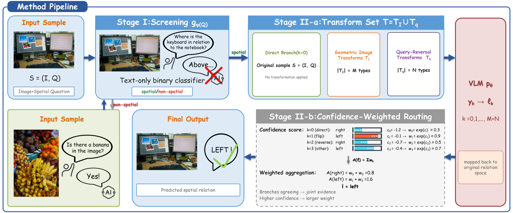

<div align="center">

# INTCORT

### Training-Free Spatial Reasoning Enhancement for Vision-Language Models via Input Transformations and Confidence Routing

[](https://www.python.org/)
[](https://huggingface.co/Qwen/Qwen2-VL-7B-Instruct)
[](#method-overview)

**Official Qwen2-VL implementation of INTCORT.**

</div>

<p align="center">
  
</p>

## Overview

Vision-language models can produce different spatial predictions for semantically equivalent views of the same input. **INTCORT** improves spatial reasoning at inference time by recovering evidence from transformed views and routing their predictions according to generation confidence.

The framework is completely training-free: it does not fine-tune the VLM or modify its internal attention and decoding modules. This release contains the Qwen2 implementation used by the project:

- **Question-structure routing:** a frozen Qwen2.5-1.5B-Instruct model classifies each question as `UNARY`, `BINARY`, or `OTHER`.
- **Input-side transformations:** spatial questions are evaluated through independent image or query transformations.
- **Relation alignment:** predictions from transformed branches are mapped back to the original spatial relation space.
- **Confidence routing:** aligned predictions are combined using the confidence scores produced during generation.
- **Safe non-spatial behavior:** `OTHER` questions use the original direct prediction without spatial transformations.

> The overview figure illustrates the complete framework. In the released implementation, Stage I is operationalized as a three-way `UNARY/BINARY/OTHER` router so that unary and binary spatial questions receive their corresponding transformation sets.

## Method Overview

Given an image-question pair, INTCORT first determines the structure of the query and then selects the corresponding inference branches:

| Router output | Executed branches | Final processing |
|---|---|---|
| `UNARY` | Direct + horizontal flip + vertical flip | Inverse mapping and unary routing |
| `BINARY` | Direct + horizontal flip + query-direction reversal | Inverse mapping and binary routing |
| `OTHER` | Direct only | Return the direct prediction |

For spatial branches, horizontal/vertical image transformations modify only the image, while query-direction reversal modifies only the question. These transformations are never composed within the same branch. The current implementation preserves the original confidence and routing rules used in our experiments.

## Released Models

| Component | Default model | Purpose |
|---|---|---|
| Vision-language model | [Qwen2-VL-7B-Instruct](https://huggingface.co/Qwen/Qwen2-VL-7B-Instruct) | Direct and transformed visual inference |
| Question router | [Qwen2.5-1.5B-Instruct](https://huggingface.co/Qwen/Qwen2.5-1.5B-Instruct) | `UNARY/BINARY/OTHER` classification |

This repository currently provides the **Qwen2-VL implementation only**. Model weights and benchmark data are not included.

## Installation

### 1. Clone the repository

```bash
git clone https://github.com/serendipityaaa/INTCORT.git
cd INTCORT
```

### 2. Create the environment

```bash
conda create -n intcort python=3.10 -y
conda activate intcort
pip install -e .
```

Alternatively, install the dependencies directly:

```bash
pip install -r requirements.txt
```

GPU inference is recommended. Our original experiments used NVIDIA A800 80GB GPUs. The Qwen2-VL model is loaded in `bfloat16`, and the router is loaded in `float16`.

## Model Preparation

The scripts accept either Hugging Face model identifiers or local checkpoint paths.

### Hugging Face identifiers

```text
Qwen/Qwen2-VL-7B-Instruct
Qwen/Qwen2.5-1.5B-Instruct
```

### Local checkpoints

```text
/path/to/Qwen2-VL-7B-Instruct
/path/to/Qwen2.5-1.5B-Instruct
```

No checkpoint path is hard-coded in the released implementation.

## Quick Start

Run INTCORT on one image-question pair:

```bash
python scripts/infer.py \
  --image path/to/image.jpg \
  --question "Where is the mug in relation to the knife?" \
  --candidate-relations left right front behind \
  --vlm-path Qwen/Qwen2-VL-7B-Instruct \
  --router-path Qwen/Qwen2.5-1.5B-Instruct
```

For a unary spatial question:

```bash
python scripts/infer.py \
  --image path/to/image.jpg \
  --question "Where is the refrigerator in the photo?" \
  --candidate-relations left right top bottom \
  --vlm-path Qwen/Qwen2-VL-7B-Instruct \
  --router-path Qwen/Qwen2.5-1.5B-Instruct
```

The command prints a JSON record containing the router decision, final prediction, generated response, confidence score, and all executed branches.

<details>
<summary>Example output structure</summary>

```json
{
  "route": "binary",
  "prediction": "right",
  "direct_text": "right",
  "branches": {
    "direct": {
      "text": "right",
      "prediction": "right",
      "confidence": -0.31
    },
    "horizontal": {
      "text": "left",
      "raw_prediction": "left",
      "prediction": "right",
      "confidence": -0.18
    },
    "reverse": {
      "text": "left",
      "raw_prediction": "left",
      "prediction": "right",
      "confidence": -0.24
    }
  }
}
```

</details>

## Dataset Format

The generic evaluator reads a JSONL manifest. Each line represents one sample:

```json
{
  "id": "sample-1",
  "image": "images/example.jpg",
  "question": "Where is the mug in relation to the knife?",
  "answer": "left",
  "candidate_relations": ["left", "right", "front", "behind"]
}
```

Required fields:

- `image`: image path relative to `--image-root`, or an absolute path;
- `question`: the original question presented to the router and VLM;
- `answer` or `gold`: ground-truth answer used only for evaluation;
- `candidate_relations`: allowed spatial relations used for prompt construction and answer extraction.

The ground-truth answer is never passed to the router or used for branch selection.

## Evaluation

Evaluate a JSONL manifest with:

```bash
python scripts/evaluate.py \
  --manifest path/to/manifest.jsonl \
  --image-root path/to/dataset \
  --output outputs/predictions.json \
  --vlm-path Qwen/Qwen2-VL-7B-Instruct \
  --router-path Qwen/Qwen2.5-1.5B-Instruct
```

The output file contains the overall accuracy and complete branch-level records for every sample. This generic interface is intentionally independent of private server paths and benchmark-specific directory layouts.

## Python API

```python
from intcort import INTCORT

engine = INTCORT(
    vlm_path="Qwen/Qwen2-VL-7B-Instruct",
    router_path="Qwen/Qwen2.5-1.5B-Instruct",
)

result = engine.predict(
    image="path/to/image.jpg",
    question="Where is the mug in relation to the knife?",
    candidate_relations=["left", "right", "front", "behind"],
)

print(result.route)
print(result.prediction)
print(result.to_dict())
```

## Supported Relation Alignment

The released inverse mappings cover the spatial relations used in our experiments:

- Horizontal flip: `left` $\leftrightarrow$ `right`;
- Vertical flip: `top` $\leftrightarrow$ `bottom`, `above` $\leftrightarrow$ `below`, and `on` $\leftrightarrow$ `under`;
- Query reversal: `left` $\leftrightarrow$ `right`, `above` $\leftrightarrow$ `below`, `front` $\leftrightarrow$ `behind`, and `on` $\leftrightarrow$ `under`.

Query reversal currently supports the question templates used by the released spatial benchmarks. If a question is routed as binary but cannot be safely reversed, the implementation falls back to the direct prediction.

## Repository Structure

```text
INTCORT/
├── assets/
│   └── overview.png          # Framework overview
├── examples/
│   └── sample.jsonl          # Example input manifest
├── intcort/
│   ├── inference.py          # End-to-end INTCORT pipeline
│   ├── model.py              # Qwen2-VL generation backend
│   ├── router.py             # Qwen2.5-1.5B question router
│   ├── transforms.py         # Transformations and inverse mappings
│   ├── parsing.py            # Relation extraction and routing rules
│   └── types.py              # Serializable output types
├── scripts/
│   ├── infer.py              # Single-sample inference
│   └── evaluate.py           # JSONL evaluation
├── tests/
│   └── test_core.py          # Core transformation/routing tests
├── pyproject.toml
└── requirements.txt
```

## Testing

Core tests do not require loading the model checkpoints:

```bash
python -m unittest discover -s tests -v
```

## Citation

If you find this project useful, please cite our paper. The final BibTeX entry will be added after the public paper release.

## Acknowledgements

This implementation builds on [Qwen2-VL](https://github.com/QwenLM/Qwen2-VL), [Qwen2.5](https://github.com/QwenLM/Qwen2.5), Hugging Face Transformers, and `qwen-vl-utils`.

